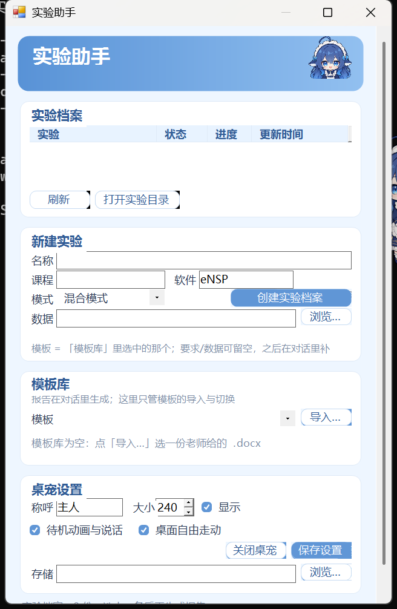
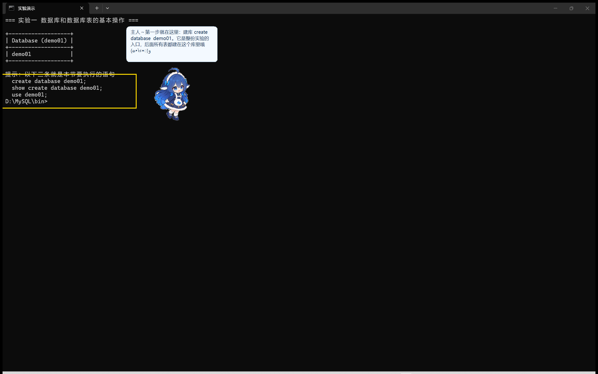
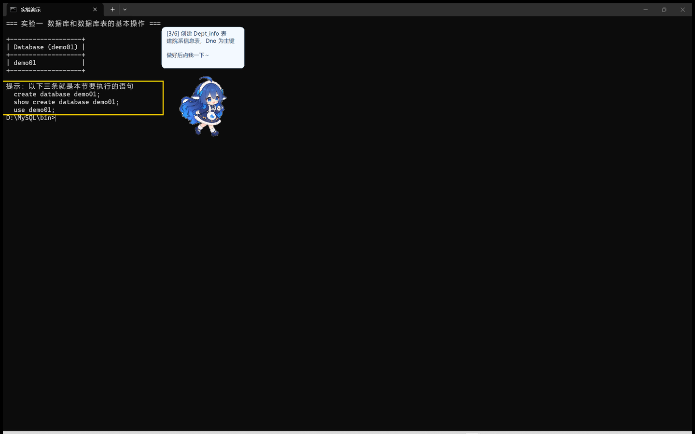

# 实验助手 · dsh-lab-assistant

面向高校实验课程的 DSH 桌宠式实验流程插件：桌宠负责指引与取证，工具集负责档案、经验与报告，DSH（模型）负责理解要求、判断界面、写正文。不伪造实验过程，不会在后台安装或卸载软件，也不修改系统设置。

> 当前状态：`0.14.3` 开发版。本版是安全与稳定性补丁：教学校验命令加白名单、截图落点受限、口令不进命令行也不落盘、被拒绝的命令不再判为通过。面板已改为「资料库」（实验档案 / 新建实验 / 模板库 / 桌宠设置），报告在对话里生成；三种模式为代码级硬约束（`guided` 不代点）；教学循环支持「点一下桌宠」自动判断对错并进入下一步。完整变更见 [CHANGELOG.md](CHANGELOG.md)，安全边界见 [SECURITY.md](SECURITY.md)。



上图是「实验助手」面板（桌面伴随进程里的 WinForms 面板，不注入 DSH 页面）：实验档案、新建实验（含数据文件）、模板库（按科目切换）、桌宠设置。**报告不在这里生成**——在对话里说「按要求生成实验报告」即可。

下图为指引模式的实际效果：黄色描边框指出该操作的位置，大肥鱼站在旁边指着并讲解：



教学循环（guided）：每一步给一条命令，学生做完**点一下桌宠**，桌宠自己跑校验命令判断对错，通过就自动指下一步：



## 宣传片

[](docs/promo/lab-assistant-promo.mp4)

约 70 秒：十种待机小动作、DSH 对话建档案 / 只读环境检查 / 记录实测值、点桌宠判对错、按老师模板生成报告，以及「再来一只桌宠」的多只同屏。配音与背景音乐均由脚本生成，画面全部由插件素材合成（`scripts/promo_tts.py` + `scripts/promo_video.py`）。

## 执行规则（硬性，优先于一切）

1. **按文档要求决定粒度，不自己加戏、也不偷懒合并**：
   先用使用者给的 PDF / 实验指导书数清楚**文档自己分成几步**，就按那个粒度走。
   - 文档把 7 张表的建表语句分成 7 节（如「4.3.1 … 4.3.7」）→ 就 7 步、7 张图；
   - 文档只用一段话讲完建库建表、并明说「一次性执行」→ 就按它的一段来，不必硬拆；
   - 文档没写清粒度 → **按文档小标题/编号分**，仍拿不准就问使用者一句。
   判断依据是**文档**，不是"我觉得哪一步值得截"。合并或拆分都必须能在文档里找到对应。
2. **截图必须有可读内容**：命令类步骤要让终端回显（追加 `show tables`、加 `-v`、或 `echo` 分段），
   只有空提示符的截图不算证据。
3. **没有截图不许写实测值**：`actual` 只写亲眼在截图/输出里看到的结果，不推测。
4. **引导模式（guided）不代劳**：只指路、讲解、截图核对，操作由学生完成；
   `desktop_click` 在 guided 档案下会直接拒绝。
5. **待补必须解释**：报告生成后要逐条说明缺口原因（模板不匹配／没做到／需人工补），不许静默交付。

## 指引模式（guided）怎么用

1. **先固定窗口**：`desktop_place` 把目标窗口摆到固定矩形。位置一变，坐标经验就失效。
2. **一步步指**：`desktop_guide` 给出 `x/y/w/h`（相对**整窗**，含标题栏，与截图、点击同一基准）、`pad`、`sticky:true`
   ——黄色描边框 + 桌宠指过去 + 大肥鱼口吻气泡。
3. **黄框宁大勿小**：默认 `w/h = 200×56`，再向外 `pad = 36`。
   稍偏一点没关系，**框够大，使用者一眼就能看到该看的地方**；宁可框住一片，也别框成一个小点。
4. **钉住不消失**：`sticky:true` 时框和气泡会一直留在原位，**直到这一步被记完或调 `desktop_clear`**。
   学生可以慢慢操作、切窗口、回来接着看。
5. **位置会被记住**：每次调用都会写进 `guide-presets.json`（键 = 软件::窗口）。
   下次同一个窗口**不给坐标也能指到上次那个位置**，越用越准。
6. **记完自动收**：`experiment_record_result(passed:true)` 成功后会自动清除框和气泡。

> 坐标怎么定：先 `desktop_screenshot` 截图 → 看图量出目标在整窗里的位置 → 传给 `desktop_guide`。
> 第一次可能差一点，改一次就会进经验库。

## 教学循环：点一下就进下一步（0.14.0）

学生的体验是"做一步 → 点一下桌宠"，而不是"做一步 → 告诉 DSH → 等回复"：

```
DSH  →  desktop_tutorial(实验编号, 窗口, steps[])
       每个 step 带：title/text/x/y/w/h + verifyCmd + verifyExpect
桌宠  →  立刻指第 1 步（黄框钉住 + 气泡覆盖）
学生  →  照着做
桌宠  →  点我一下 ⇒ 跑 verifyCmd ⇒ 输出里找 verifyExpect
        ✓ 命中 → 记一条回执 → 自动指下一步
        ✗ 没命中 → 气泡提示"还没看到 xxx"，留在本步
```

- **校验是跑真命令**，不是看截图猜：`mysql -N -e "show databases like 'demo01_exp'"` 输出里有 `demo01_exp` 才算过。
- **不需要 DSH 在线**：循环跑在桌宠进程里，DSH 断了也能继续带。
- **不会误判**：校验不过就停在原地（实测：故意给一个失败的步骤，点 2 次仍停在 index=2）。
- **回执落盘**：`<实验>/tutorial-claims.jsonl`，每行 `{stepId,index,passed,cmd,expect,output,at}`；
  之后 DSH 用 `tutorial_claims` 读回来，正式写进档案（`experiment_record_result`）。
- 也提供 `desktop_tutorial_step`：不想点桌宠时，可以让 DSH 代为推进一步（调试/无人值守）。

## 已实现

- **DSH bundle 插件**：`dsh.bundle.patch` 标准挂载；桌宠与"实验助手"面板只存在于桌面伴随进程，DSH 网页不再注入任何桌宠 UI。
- **桌面桌宠（大肥鱼）**：点击启动；默认称呼"主人"；气泡文字 + 窗口/控件高亮 + 移动指向；透明置顶、可在桌面任意位置拖动。
- **实验档案**：新建独立实验目录，保存清单、截图目录、数据目录、报告目录和日志目录。
- **历史实验**：按状态和关键词列出，可读取和更新，不再依赖单个聊天上下文。
- **只读环境探测**：检查 eNSP、VirtualBox、WinPcap、Npcap、Wireshark、CPU 虚拟化和 Hyper-V 状态；也可以按名称检查目录中的其他软件。
- **跨学科软件目录**：覆盖 14 个学科方向、67 项代表软件，记录优先级、授权方式、控制方式和适配状态。
- **配置适配引擎**：根据环境指纹、已装版本、课程要求和“当前是否能正常运行”，区分保留现有环境、先诊断、或更换版本组合；推荐不等于安装授权。
- **失败驱动找版本**：把报错原文匹配到已知失败特征，给出原因、检查项和按证据排序的候选版本；每试一个版本可记录“可用／失败”，下次自动降权或提前。
- **实验报告引擎**：解析 .docx/.md 模板的章节、必填项、表格列和封面字段；按实验档案生成 Word 与 Markdown 初稿，截图自动按文件名顺序插入。
- **不伪造结果**：报告只使用档案里真实存在的环境、步骤、截图和故障记录；实测值必须来自 `lab_experiment_record_result` 记录的真实执行结果；个人身份字段留空并列出清单。
- **桌面伴随进程（P0）**：DSH 启动时自动拉起独立桌宠（透明置顶、可拖动、右键菜单），能在任意软件窗口/控件旁画高亮框、出气泡讲解，并真实截取目标窗口存入实验档案。**能点击，但有闸门**：`desktop_click` 默认真点，点击前校验该坐标确实属于目标进程（不属于直接拒绝），坐标越界拒绝；`guided` 模式下代码层面禁止代点。
- **实验助手面板 = 资料库，不是生成器**：点桌面上的大肥鱼弹出面板，四块——**实验档案**（列表/刷新/打开目录）、**新建实验**（名称/课程/软件/模式/数据文件，数据文件用「浏览…」点选，避开文件对话框自动化不可靠的问题）、**模板库**（下拉切换已导入模板 + 导入…，按科目随时换）、**桌宠设置**（称呼/大小/显示/动画/走动/关闭/保存/存储路径）。**报告生成已移到对话里**：在任意会话说「按要求生成实验报告」，DSH 读模板与要求后调用本插件生成。
- **桌宠会动、会说话、会自己溜达**：待机时有呼吸与轻浮动动效，还会随机做喝咖啡、敲键盘、看书、伸懒腰等 10 种小动作（有对应图片才播）；空闲时在屏幕工作区内随机走走停停，走动带小跳与身体摇摆，向左走自动镜像翻转；拖拽或打开面板时暂停。气泡台词全部来自本地预设，**不消耗模型 token**。生成报告成功会开心、失败会疑惑；引导时 0.5 秒内冲刺到目标旁再高亮。动画帧缺失时自动退化成程序内微动效，无需额外素材也能动。
- **面板视觉**：柔和蓝白卡片式布局，与桌宠同风格；按钮和输入框按文字宽度排布，不再出现文字截断。
- **页面地图**：把 UIA 能读到的控件采集成“软件名 + 版本”的地图，之后按控件名一键指引；控件位置每次实时获取，不写死坐标。
- **证据分级**：本机经验库 > 同系统版本实测 > 他机实测 > 厂商文档 > 社区经验；别人电脑上跑通的版本不会被标成“保证可用”。
- **单机最小实验验证**：Python 3.12.10、Weka 3.8.7、MySQL 8.0.46、ImageJ 1.54f 已完成 Windows 11 x64 最小实验；结果见 [docs/VERIFICATION_2026-10-28.md](docs/VERIFICATION_2026-10-28.md)。
- **保守安全策略**：检查不写入系统；提示只说明“需要核对”，不会自动卸载、改驱动或关闭虚拟化。
- **可替换桌宠素材**：用户生成的 PNG 放入 `assets/pet/` 并更新 manifest 即可；缺图自动回退到占位图。

- **三种模式是硬约束**：`guided`（新手指引，禁止代点，用黄色高亮框 + 桌宠指向 + 气泡讲解，学生自己操作）、`mixed`（默认，只读/可逆自动做，不可逆先问）、`automatic`（连续执行，失败或不可逆前才停）。模式记在实验档案里，`desktop_click` 会真的按模式拒绝。
- **软件经验库**：`note_add` / `note_list` 按软件累积「坑 / 位置 / 技巧」；交接单会自动附上该软件已知经验，同类实验第二次不用重新试错。
- **标准流程可自取**：`workflow` 动作返回八步流程与被挡时的替代方案，任何会话都能取。
- **提交前不留空**：`report_generate` 支持 `sectionTexts`，DSH 可把「目的/环境/内容/分析/总结」亲笔写进对应章节；封面可填姓名/学号；截图去重且全篇连续编号。
- **交接单**：每次生成报告同时写出 `reports/handoff.md`，列明缺口、该软件经验、每步实测，方便换会话接手。

- **指引位置经验库**：`guide-presets.json` 按「软件::窗口」记住框的位置与大小，含使用次数；下次不给坐标直接复用。
- **框可放大、可钉住**：`pad` 向外扩（默认 36），`sticky` 钉住到该步完成；`desktop_clear` 手动清。
- **统一整窗坐标**：截图、点击、指引三处都以整窗左上角为原点（`client:false` 为默认），拿截图量出来的坐标可以直接用；`client:true` 仍可显式要求客户区基准。旧版（客户区基准）存下的位置经验会被自动忽略并重新积累。
- **越用越强的两条线**：
  1. **报告线**：`note_add`/`note_list` 软件经验 + `experiment_clone` 复用步骤骨架与 `where` + `sectionTexts` 亲笔正文 + 模板库按科目切换；
  2. **指引线**：`guide-presets.json` 记住每个窗口的框位置，第二次做同类实验直接复用，试错次数递减。

## 尚未实现

- 面向软件的**键盘输入**（往软件窗口里打字）；当前只有点击与命令行执行。
- 步骤失败后的**自动修复分支**：教学循环只会停在失败步并提示，不会自己换方案重试。
- 自动截图打码、实验证据与步骤的自动关联。
- 复杂 Word 版式还原：公式、图表自动编号、学校定制封面样式仍会退化，需要模板级适配。
- 跨用户共享的兼容档案（当前经验库只存在本机，不上传）。
- 部分软件的 UIA 控件暴露有限（如 eNSP 这类 Qt 程序），控件级定位会回退为整窗高亮。

这些边界是刻意保留的，避免用"自动做实验"掩盖尚未验证的软件控制能力。

## 安装

> 本机没有独立的 `dsh` 命令行工具；安装统一通过 **DSH 桌面端内置的 `plugin_manager`** 完成。桌宠与"实验助手"面板只在 **Windows 桌面端** 出现，Web profile 不会显示桌宠（只有对话工具可用）。

### 方式一：本地目录链接（开发/调试首选）

在 DSH 桌面端对话里说：

```text
请用 plugin_manager 安装本地插件目录 <本仓库目录>，装完告诉我结果和是否需要重启。
```

目录链接指向实时源码，改完代码重启 DSH 即生效，适合边改边测。

### 方式二：本地 tgz 包（更接近发布形态）

仓库执行 `npm pack` 会生成 `dsh-lab-assistant-<版本号>.tgz`，把它交给 DSH 桌面端的 `plugin_manager` 安装即可。

### 重启

首次安装或升级后，**完全退出 DSH（包括右下角托盘图标）再重新打开**。若你的 DSH 环境提供命令行 `dsh plugin add`，也支持 `dsh plugin add link:<目录>` 或 `dsh plugin add <tgz路径>`，具体子命令以当前 DSH 版本为准；本插件面向 DSH `>= 0.2.0`。

## 使用

1. 安装并重启 DSH，桌面右下角出现大肥鱼（首次启动会自动编译伴随进程，约几秒）；
2. 点大肥鱼 → 弹出“实验助手”面板：实验档案列表、新建实验（含数据文件）、模板库、桌宠设置；**生成报告在对话里说「按要求生成实验报告」**；
3. 拖动可挪位置；要对某软件做引导，先对 DSH 说“给 XX 采集页面地图”，之后每一步它都会指位、高亮、讲解；
4. 报告生成在 `experiments/<实验编号>/reports/` 下，面板里可一键打开所在文件夹；
5. 对 DSH 直接说话也可以完成同样的事（工具名见下表）。

## DSH 工具

> **0.7.3 起：下表 31 个工具合并成一个入口 `lab_assistant`。** 表里的工具名改为 `action` 取值，
> 其余参数放进 `args` 对象：`lab_assistant(action: "desktop_status")` 等价于原来的 `lab_desktop_status`。
> 旧全名也兼容（`action: "lab_desktop_status"` 同样可用）。
> 原因：工具定义会随**每次**模型请求一起发送，31 个约 4000~5500 tokens，合并后约 1500。

| 工具（= action 取值） | 作用 |
|---|---|
| `lab_assistant_status` | 查看插件、实验数量、称呼、素材和本地数据目录 |
| `lab_workflow` | 取回标准八步流程与被挡时的替代方案 |
| `lab_experiment_create` | 新建独立实验档案，不执行软件操作 |
| `lab_experiment_clone` | 复制上一份实验的步骤骨架，结果清空 |
| `lab_experiment_list` | 按状态或关键词列出历史实验 |
| `lab_experiment_get` | 读取完整实验档案 |
| `lab_experiment_update` | 更新步骤、进度、模式或备注 |
| `lab_experiment_record_result` | 记录步骤的真实实测值与是否通过，供报告填结果表 |
| `lab_note_add` | 记一条软件经验（坑 / 位置 / 技巧） |
| `lab_note_list` | 读某个软件的已有经验 |
| `lab_software_catalog` | 查询 14 个学科、67 项代表软件的知识目录 |
| `lab_compatibility_advise` | 根据电脑环境推荐保留、诊断或更换兼容组合 |
| `lab_repair_plan` | 按报错原文定位失败原因，给出排序后的候选版本与操作顺序 |
| `lab_repair_record` | 记录某版本在本机可用或失败，写入本机经验库 |
| `lab_report_template` | 导入/列出实验报告模板，识别章节与表格结构 |
| `lab_report_plan` | 生成填充计划：哪些节能自动填、缺哪些证据 |
| `lab_report_generate` | 生成 Word 与 Markdown 报告初稿，输出到实验档案 |
| `lab_environment_probe` | 只读检查 Windows 实验软件环境，可按名称检查 |
| `lab_desktop_status` | 查看桌面伴随进程与桌宠状态 |
| `lab_desktop_pet` | 显示/隐藏/移动桌面桌宠，改称呼 |
| `lab_desktop_guide` | 定位软件窗口/控件，桌宠引导 + 高亮 + 气泡 |
| `lab_desktop_click` | 在目标窗口内点击；**默认真点**，`confirm:false` 才是预演 |
| `lab_desktop_place` | 把实验软件窗口归位到固定矩形，保证截图可比 |
| `lab_desktop_screenshot` | 真实截取目标窗口并存入实验档案 |
| `lab_desktop_clear` | 清掉当前高亮框与气泡 |
| `lab_desktop_tutorial` | 启动教学循环：学生点桌宠即跑校验命令并自动进下一步 |
| `lab_desktop_tutorial_step` | 手动推进一步教学循环（调试/无人值守） |
| `lab_tutorial_claims` | 读教学回执（每步的校验命令与输出） |
| `lab_page_map_capture` | 采集软件控件的页面地图（按软件+版本保存） |
| `lab_page_map_guide` | 按页面地图指引某控件 |
| `lab_page_map_list` | 列出已保存的页面地图 |

## 配置适配方式

插件先判断用户当前环境属于哪一类：

1. **当前可用**：保留现有版本组合，不为了“最新版”卸载重装；
2. **已安装但状态未知**：先采集版本、错误码、虚拟网卡和最小启动结果；
3. **确认无法运行**：展示候选版本组合、安装顺序、冲突项、回退方法和最小测试；
4. **没有安装**：根据课程要求、系统版本、内存与虚拟化条件选择合适方案；
5. **装完仍然报错**：匹配失败特征 → 给候选版本和安装顺序 → 记录试过的结果 → 下次优先用本机验证过的版本。

引擎只提供方案，安装或修改系统设置必须另行确认。首批完整适配档案是 eNSP；更多软件先进入目录，再逐项建立版本矩阵。详见 [docs/COMPATIBILITY_ENGINE.md](docs/COMPATIBILITY_ENGINE.md) 和 [docs/SOFTWARE_CATALOG.md](docs/SOFTWARE_CATALOG.md)。


## 实验报告引擎

目标只有一个：**把重复劳动压掉，但不替你编实验。**

```text
老师发的模板（.docx / .md）
→ 解析章节层级、必填项、表格列、封面字段
→ 和实验档案对账
→ 能自动填的：实验环境、步骤、截图、数据文件、故障处理记录
→ 不能自动填的：目的、原理、分析、总结、班级、教师
→ 全部标【待补】；报告文件内不写入"自动草稿/模板要求/提交前检查"等元信息，避免混入最终文档
→ 输出 Word(.docx) + Markdown
```

自动填充的判定很保守：

| 章节 | 自动填什么 | 条件 |
|---|---|---|
| 实验环境 | 操作系统 build、内存、已装软件版本 | 只读探测成功 |
| 实验步骤 | 档案里录入的步骤与预期 | 有步骤记录 |
| 实验结果 | 截图（最多 6 张）、数据文件、备注 | 目录里真有文件 |
| 问题与解决 | 本机经验库里的版本尝试记录 | 有真实记录 |
| 目的/原理/分析/总结 | 自动组织文字稿（基于真实步骤/软件信息/数据摘录） | 结论须本人核对补充；文件内不留"自动草稿"字样 |
| 实验拓扑 | 文件名含“拓扑”的截图自动插入 | 有截图且不超过 8 MB |
| 班级/专业/指导教师 | 不填 | 个人信息留空 |

生成的 Word 使用真实的标题样式、表格与内嵌图片，可直接继续编辑。模板封面字段（实验名称、姓名、学号、班级、指导教师）会按原顺序保留，能对上档案的自动填，其余留空。

注意：只还原结构，不还原学校专属字体、页眉页脚、公式和自动编号；扫描版 PDF 模板不支持；文字章节是草稿，不是替你写结论。详见 [docs/REPORT_ENGINE.md](docs/REPORT_ENGINE.md)。

桌面桌宠 P0 已实现：首次运行会用系统自带 .NET Framework 编译器（csc.exe）一次性编译 `overlay/LabPet.cs` 并随 DSH 启动；细节与边界见 [docs/DESKTOP_PET_OVERLAY.md](docs/DESKTOP_PET_OVERLAY.md)。本插件只适配 DSH，不自带管理员提权通道；需要驱动级操作时由使用者自行以管理员运行 DSH。

## 本地数据

默认保存在：

```text
$DSH_HOME/lab-assistant/
├── settings.json
├── repair-history.json      # 本机换版本经验（可用/失败）
├── report-templates/        # 导入过的报告模板结构
└── experiments/
    └── exp-YYYYMMDD-HHMMSS-xxxx/
        ├── experiment.json
        ├── screenshots/
        ├── data/
        ├── reports/
        └── logs/
```

`DSH_HOME` 默认是 `~/.dsh`。所有实验资料默认留在本机，不上传。

## 桌宠素材

素材清单、角色基准和六张首批图片的生成提示词见 [docs/ART_ASSETS.md](docs/ART_ASSETS.md)。

当前已内置"大肥鱼"角色的多状态素材（统一 512×512、角色高约 460、底边留 26）：

```text
assets/pet/idle.png       待机（单张，靠程序呼吸动效）
assets/pet/swim_1..8.png  走路循环（8 帧两步，朝右，向左自动镜像）
assets/pet/dash_1..3.png  引导冲刺（3 帧：起跑/加速/急停）
assets/pet/point.png      指向
assets/pet/happy.png      开心
assets/pet/confused.png   疑惑

# 待机小动作（多帧循环，共 35 帧）
assets/pet/drink_1..4.png    喝咖啡
assets/pet/typing_1..4.png   敲键盘
assets/pet/read_1..3.png     看书
assets/pet/stretch_1..4.png  伸懒腰
assets/pet/wave_1..3.png     挥手
assets/pet/sleep_1..3.png    打瞌睡
assets/pet/snack_1..4.png    吃饼干
assets/pet/music_1..3.png    戴耳机听歌
assets/pet/wipe_1..3.png     擦汗
assets/pet/spin_1..4.png     原地转圈

assets/icon.png          插件图标（512×512）
```

**动作触发时机**（全部在桌面端本地执行）：

| 状态 | 触发条件 |
| --- | --- |
| `idle` 待机 | 默认状态；呼吸缩放 + 上下轻浮 + 定时气泡闲聊 |
| `swim` 走动 | 空闲时在屏幕工作区随机走动，8 帧走路循环；到目标后停几秒 |
| `dash` 冲刺 | 引导时 0.5 秒滑行到目标旁，播 3 帧冲刺 |
| 待机小动作 | 空闲时随机播上面 10 组之一（每轮约 5 秒，间隔 20~60 秒） |
| `point` 指向 | `lab_desktop_guide` 定位到窗口/控件时，**0.5 秒内冲刺到位**并高亮 |
| `happy` 开心 | 新建实验档案、报告生成成功 |
| `confused` 疑惑 | 报告生成失败、环境异常 |

**左右朝向**：素材只需要朝右的图；向左移动时程序自动水平镜像，不会出现“倒着走”。

**桌宠台词**：10 组小动作各有 2 句专属台词（动作开始时说），另有 8 句待机闲聊、3 句事件台词（建档案/报告成功/失败）和引导默认台词，全部本地播放、不消耗 token。所有台词里的「主人」会按面板里的「称呼」自动替换。完整台词与触发时机见 [docs/PET_DIALOGUE.md](docs/PET_DIALOGUE.md)。

要做多帧动画：按 `idle_1.png`、`idle_2.png`… 命名放入 `assets/pet/`，程序会自动按序循环；待机小动作同理（`drink_1.png`、`typing_1.png` 等，文件名对上就会随机播放），单张 `<名称>.png` 也兼容。10 组小动作的完整出图规范与提示词见 [docs/PET_ANIMATION_PROMPTS.md](docs/PET_ANIMATION_PROMPTS.md)。

要替换形象，把同名 PNG 覆盖到 `assets/pet/` 下并重新 `npm pack` 即可；首个状态 `idle.png` 是桌宠默认画面。

## 开发与验证

要求 Node.js 22 或更高版本。

```bash
npm test
npm run selfcheck
npm run pack:check
npm pack
```

本机额外做了两项真实运行验证：

- Windows 只读环境探测，确实读取到本机 eNSP、VirtualBox、WinPcap 与 Wireshark 注册信息；
- 桌宠与"实验助手"面板由独立 Windows 伴随进程承载，首次运行用系统自带 .NET Framework 编译器编译 `overlay/LabPet.cs`，DSH 网页不再注入任何桌宠 UI。

浏览器检查脚本 `test/ui-check.mjs` 验证 DSH 网页未注入桌宠、也未暴露 `window.LabAssistant`，并对建档案 + 生成报告做 API 冒烟测试。它依赖本机 Chrome 与 puppeteer-core，不属于插件运行依赖。

## 安全与隐私

- 环境探测只读，不执行安装、卸载、驱动替换或系统设置修改。
- 高风险操作必须单独确认；当前版本不提供自动修复按钮。
- 插件只从本机回环地址提供界面与 API，拒绝跨站请求；伴随进程同样只监听 `127.0.0.1`，用一次性随机 token 鉴权。
- 教学循环的校验命令走白名单（`mysql`/`python`/`node`/`java`/`git`/`dir`/`echo` 等）并拒绝 `& | < > ^` 串联；截图只能写进实验 `screenshots`、临时目录或配置目录。
- 校验命令有 15 秒超时并结束整棵进程树；本机接口有读写超时与 2 MB 请求体上限。
- **边界要说清**：白名单降低的是误用/误触发的面，不是沙箱——`python -c`、`node -e` 这类解释器本身就能执行任意代码，同用户进程也有权限自己起 `cmd.exe`。真正的边界是「只监听回环 + token + 不联网」。
- 不接入语音识别，不监听麦克风。
- 不伪造实验截图或实验结果。
- 外部软件包只作为待核对线索，不会自动运行。

## GitHub 发布

仓库已准备：

- `.github/workflows/ci.yml`：Windows CI 测试；
- `.github/workflows/release.yml`：推送 `v*` 标签时构建 npm 包并创建 GitHub Release；
- `npm pack` 生成的 `.tgz` 作为可下载安装包。

`package.json` 已填好 `repository` / `homepage` / `bugs`（指向 `oddeye4649/dsh-lab-assistant`），发布步骤与 DSH 市场上架方式见 [docs/RELEASE.md](docs/RELEASE.md)。

## 安全与隐私

看 [SECURITY.md](SECURITY.md)：本机 HTTP 只监听 127.0.0.1 且需 token、不联网；
教学校验命令有白名单（但**白名单不是沙箱**，真正的边界是同用户信任 + 不联网）；
口令不进命令行也不落盘；截图只能落在实验 `screenshots/`、临时目录或配置目录。

## 许可证

MIT
